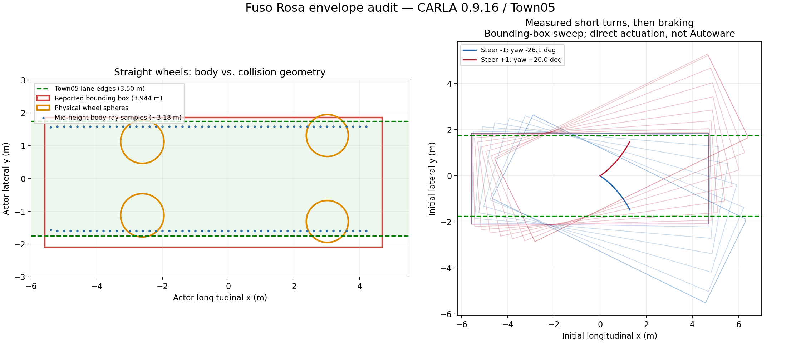

# Fuso Rosa 경계 문제 수정과 기본 주행 검증

2026-10-22, CARLA 0.9.16 / Town05_Opt / Autoware + ROS 2 Jazzy.
현재 단계의 경로 거부·명령 변환·목표 정지 문제를 수정하고 기본 주행을 검증했다.
물리 형상 측정과 실제 Autoware 주행 결과를 아래에서 구분한다.

## 수정 후 AUTO 주행 결과

| 시험 | 실제 이동 | 최고 속도 | 최대 중심선 거리 | 최종 목표 오차 | 정지 유지 | 충돌 |
|---|---:|---:|---:|---:|---:|---:|
| 직진 | 59.30m | 9.96km/h | 0.125m | 0.748m | 3.0초 | 0 |
| 곡선 | 177.25m | 10.10km/h | 0.240m | 0.735m | 3.0초 | 0 |
| 직진 재시험 | 59.19m | 9.95km/h | 0.122m | 0.856m | 3.0초 | 0 |

곡선 시험의 방향 변화는 약 87.57도다. 모든 시험은 **배경 차량·보행자가 없는
순환로 중간 차로**에서 진행했으며, 시작 위치 설정 이후 움직임은 Autoware
경로 계획·제어·페달 변환을 거쳤다. CARLA autopilot/직접 페달 명령을 사용하지 않았다.
기준 좌표는 rear axle이며, 중심선 거리는 높이 차이를 포함하는 3차원 거리다.
모든 종료에서 STOP, 시험 속도 제한 해제, 경로 해제를 확인했다.

성공 원본은 `corridor-straight-6.json`, `corridor-curve-1.json`,
`repeat-straight/straight.json`이다. `control-summary.json`에는 요약, 실행 이미지 ID,
지도·설정 해시를 기록했다. 최초 두 성공 파일의 상속된 `required_stop_hold_s: 2.0`은
이전 공통 도구 메타데이터였으며, 실제 버스 통과 조건과 `stop_hold_s`는 **3초**다.
현재 도구 및 재시험 파일은 메타데이터도 3초로 수정했다.

검증 조건은 목표 오차 1.5m 미만, 정지 속도 0.05m/s 미만 3초 유지,
최고 속도 2m/s 초과, 중심선 거리 1m 이하, 충돌 없음이다.
계획 상한은 10km/h이며 곡선의 실제 최고 속도는 약 0.10km/h 초과했다.
동기 시뮬레이션 고정 간격은 0.05초다. 정상 배속 장시간 안정성이나 전체 도심
노선 완주를 입증한 시험은 아니다.

## 해결한 문제

1. **목표 외곽 검사**: 버스 전용 옵션에서 차선 변경이 허용된 같은 방향 이웃 차로의
   실제 다각형 합집합까지 검사한다. 실선·반대 차로·도로 밖은 허용하지 않는다.
   기존 차량의 기본값은 false이며 기존 목적지 검사를 그대로 유지한다.
2. **순환로 지도**: 긴 lanelet이 native road 36→37에 걸친다는 이유로 빠진 점선 태그를
   복원했다. OpenDRIVE의 명시적 도로/차로 연결과 모든 구간의 `broken/both`를 확인한다.
   새로 16개 경계, 총 93개가 허용되며 기존 사용자 태그·형상·속도·신호는 보존한다.
   원본 Town05는 그대로 두고 별도 Town05Bus와 일치하는 신호 manifest를 설치했다.
3. **차체/충돌 영역**: 보이는 몸통 폭으로 축소하지 않고 mesh bbox와 바퀴 충돌구를
   포함하는 폭 약 4.040m의 차량 프로필을 적용했다. 오른쪽 충돌구가 기존 mesh bbox보다
   약 9.6cm 돌출해 이 부분도 반영했다. 원본 CARLA 에셋은 수정하지 않았다.
4. **경로 여유**: 버스 전용 동적 영역 확장 상한 0.75m, 추가 폭 0.6m,
   정적·동적 물체 제외와 물체 여유를 적용했다. 실선·연석·도로 경계는 확장을 제한한다.
   실제 차량이 있는 경우의 안전성은 별도 후속 검증 대상이다.
5. **가감속 변환기 종료**: 단조 회귀의 동일 값 구간이 Autoware의 엄격한 역보간 조건에
   어긋나 `Brake map is invalid`로 종료됐다. 0.001m/s² 최소 간격으로 보정하고,
   Docker 빌드에서 실제 설치된 변환기를 실행하는 검사를 추가했다.
6. **정지 후 기어감**: 움직이는 상태의 coast 측정값을 저속까지 고정한 표에서 약한 감속
   명령이 가속 페달로 변환됐다. 버스용 최종 정지 상태, 실제 제동이 걸리는 감속 값,
   정지 유지와 overshoot emergency를 설정한 뒤 위 세 주행 시험에서 확인했다.
   페달 표는 2.78/5.56m/s 부근 측정 기반이며 전 속도·경사 조건의 보정 완료를 뜻하지 않는다.
7. **실행 구성**: bus overlay의 라이브러리/패키지를 우선 로드하고, 재시작 때 CARLA의
   완전한 actor snapshot을 기다린 뒤 이전 차량을 정리한다.

## 검사와 실패 이력

- mission planner C++ **17/17**, 브리지 **22/22**: `regression-tests.log`.
  점선/실선·반대 방향·도로 밖·종방향 끝 경계 검사를 포함한다.
- 지도 보완 검사 **8/8**: `map-tests.log`. 원본 속도·신호·형상·사용자 금지 보존,
  idempotence, 도로 연결 검증과 순환로 복원 검사 포함.
- 버스 변환기 실제 시작: `build-converter-fix.log`, `build-stop-fix.log`.
- 최종 ROS 연결 **21/21**: `final-bus-runtime-check.json`.
- 실제 적용된 목적지 검사·영역 확장·정지 제어·CSV 경로: `final-parameters.json`.
- `corridor-straight-1.log`: 초기 차량 준비 대기 문제.
- `corridor-straight-2.*`: 지도 점선 태그 누락으로 경로 거부.
- `corridor-straight-3.log`: 시험 도구 의존 파일 복사 누락, 주행 시작 전 실패.
- `corridor-straight-4.*`, `stationary-diagnosis.json`: 변환기 종료로 주행 불가.
- `corridor-straight-5.*`, `stop-diagnosis.json`: 정지 후 기어감 재현, 수동 시험 중단/STOP.
- 최초 이미지 빌드의 overlay 라이브러리 충돌도 `build-corridor.log`에 보존했다.

재현 명령은 [버스 운영 안내](../../carla-bus-operations.md)를 따른다.
**단계 1은 완료했으며**, 다음은 전체 노선의 교차로·신호·바깥 차로 접근 검증이다.
10개 정류장 조건부 정차, 하차벨 UI, 대기 승객 처리와 주변 차량 충돌 여유 검증은
아직 완료되지 않았다.

## 확인된 원인

| 대상 | 측정 폭 | 방법 |
|---|---:|---|
| 몸통 중앙 단면 | 약 3.180m | 옆으로 접근하는 물리 상자의 정지 위치 |
| 앞바퀴 충돌 범위 | 약 3.896m | 같은 상자 접촉 시험, 정면·최대 좌우 조향 |
| 앞바퀴 에셋 계산 | 3.89457m | 바퀴 중심 간 거리 + 두 구형 충돌체 반지름 |
| CARLA 보고 bounding box | 3.94415m | 차량 API |
| Town05 한 차로 | 3.5m | native 지도 |

몸통이 화면에서 차로 안에 보인다는 관찰은 맞다. 하지만 바퀴에는 몸통보다 옆으로
돌출한 구형 물리 충돌체가 있다. `Phys_FusoRosa`의 앞바퀴 반지름은 63.89472cm,
뒤는 약 65.97995cm이며, `CollisionEnabled=QueryAndPhysics`,
`PhysicsType=PhysType_Kinematic`으로 저장되어 있다. 앞바퀴 중심의 lateral 위치는
약 ±1.30834m다. 계산값과 실제 물체가 막힌 위치가 일치한다.

단순히 Autoware 폭을 3.18m로 축소하면 물리 충돌체를 누락한다.
또한 mesh bbox는 좌우 비대칭이고 오른쪽 앞바퀴 충돌구가 bbox보다 약 9.6cm 더
돌출한다. 현재 차량 프로필은 bbox와 바퀴 충돌구의 합집합을 반영하도록 보정했다.
에셋을 수정하거나 축소하지 않았다.



## 시험 방법과 한계

- 기존 Autoware 실행을 정지하고 빈 Town05에서 시험 소유 차량만 생성.
- 정면·좌우 중간·좌우 최대 입력, 총 5개 상태에서 0.2m 격자의 측면 ray 조회.
  실제 앞바퀴 각도는 0/0, -35/-27.85, +27.85/+35, -70/-50.35, +50.35/+70도.
- 정면·최대 좌우 조향 × 좌우 접근 × 몸통/앞바퀴/최대 ray 위치 = 18개 접촉 조건.
  `static.prop.box01`을 중력 없이 0.4m/s로 접근시켰다. 자유 이동을 확인한 뒤,
  동일 속도 명령에도 이동 속도가 0.05m/s 미만으로 10 tick 유지되는 물리 차단을 기록했다.
  이 시험에서는 collision sensor 이벤트가 발생하지 않았으므로 이벤트 검출 성공이라고
  표기하지 않는다. 접촉 위치는 상자 nominal 반폭을 이용한 근사이며 오차 여유 ±3cm로 본다.
- 첫 시도는 센서 이벤트만을 완료 조건으로 삼아 중단되었다. 상자가 몸통에서 실제로
  멈춘 기록을 보존하고, 자유 이동 후 물리 차단 조건으로 다시 시험했다.
- `cast_ray`는 overlap 채널 조회다. 조회 결과만으로 물리 충돌을 단정하지 않았으며,
  에셋 속성 및 독립적인 물체 접근 시험으로 확인했다.
- 최대 조향 저속 좌우 회전을 약 26도씩 수행하고 제동했다. 최고 속도 약 4.68km/h,
  종료 속도 약 0.008m/s, 충돌 센서 이벤트 0건. 전체 bbox가 지나간 lateral 범위는
  좌회전 [-5.52, 2.64]m, 우회전 [-2.86, 5.28]m이다. 이 수치는 초기 차량 좌표계에서
  시간에 걸쳐 합친 영역이며 한 순간의 차량 폭이나 90도 교차로 회전 시험 결과가 아니다.
- direct CARLA actuation을 사용한 형상 시험이다. 신호 준수나 Autoware 완주 증거가 아니다.

## 기록과 재현

- `summary.json`: 프로필 수정 전 물리 형상 감사의 주요 수치 및 조건.
- `control-summary.json`: 수정 후 AUTO 주행 결과와 최종 구성 해시.
- `physics-asset.json`: 읽기 전용 에셋 속성 추출과 원본 파일 SHA256.
- `audit.json.gz`: 5개 조향 상태 ray 표본과 18개 물리 접근 시험의 프레임별 기록.
- `audit-attempt1.json.gz`: 센서 이벤트 완료 조건으로 중단한 첫 시도.
- `turns.json`: 짧은 좌우 회전의 프레임별 속도·조향·bbox 좌표.

```bash
# 1. 다른 tick 소유자와 차량이 없는 빈 Town05에서만 실행
./scripts/carla/carla_autoware stop
/home/a/CARLA/venv-0.9.16/bin/python tools/carla_bus_envelope_audit.py --output /tmp/audit.json
/home/a/CARLA/venv-0.9.16/bin/python tools/carla_bus_turn_envelope_probe.py --output /tmp/turns.json
# 2. 읽기 전용 cooked asset 검사
python3 tools/inspect_fusorosa_physics_asset.py --output /tmp/physics-asset.json
```

에셋 판독기는 해당 cooked UE4 패키지 형식을 검증한 뒤 제한적으로 읽는다.
일반 Unreal 에셋 편집기가 아니며 원본 에셋을 쓰지 않는다.

CARLA 0.9.16 원본 근거:
[RayTracer.cpp](https://github.com/carla-simulator/carla/blob/0.9.16/Unreal/CarlaUE4/Plugins/Carla/Source/Carla/Util/RayTracer.cpp),
[BoundingBoxCalculator.cpp](https://github.com/carla-simulator/carla/blob/0.9.16/Unreal/CarlaUE4/Plugins/Carla/Source/Carla/Util/BoundingBoxCalculator.cpp),
[CarlaWheeledVehicle.cpp](https://github.com/carla-simulator/carla/blob/0.9.16/Unreal/CarlaUE4/Plugins/Carla/Source/Carla/Vehicle/CarlaWheeledVehicle.cpp).

대용량 형상 표본과 실패 주행 원본은 손실 없이 gzip으로 보관했다.
`compressed-records.json`의 SHA256은 압축 전 JSON 기준이다.
예: `gzip -dc audit.json.gz > /tmp/audit.json`.
성공한 주행 JSON은 저장소에서 바로 열 수 있도록 그대로 보관했다.
