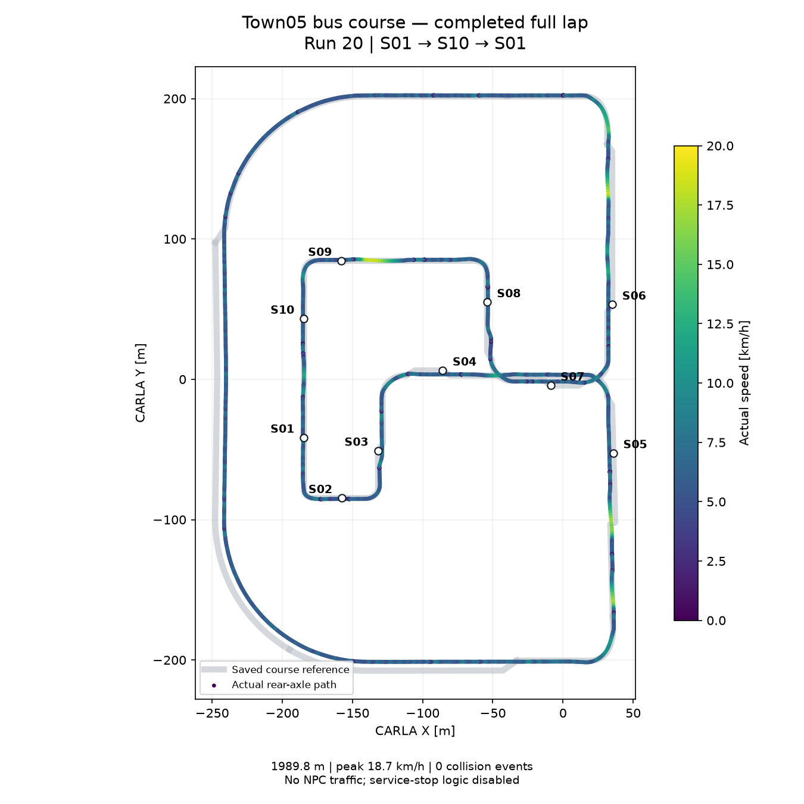

# Town05 버스 정류장 노선 완주 — 2026-10-22

**Run 20에서 S01 → S10 → S01 한 바퀴를 완주했다.** 정류장 10개와 순환로 경유점을
순서대로 통과했고, S10 정지 후 재출발 및 S01 복귀 정지를 확인했다.
CARLA Fuso Rosa 한 대, GT 객체 입력/direct localization, NPC 차량·보행자 없는 조건이다.
주행 중 설정 변경, 중간 위치 이동, CARLA autopilot 또는 직접 페달 제어는 없었다.
시작할 때만 S01에 배치하고, 주행은 Autoware 계획·제어를 사용했다.

| 항목 | 결과 |
|---|---:|
| 실제 누적 거리 | 1,989.83 m |
| S01 → S10 / S10 → S01 | 1,904.80 m / 85.04 m |
| 속도 상한 / 실제 최고 | 20.0 / 18.65 km/h |
| 평균 속도(신호·안전 정지 대기 포함) | 5.06 km/h |
| 두 주행 구간 합계 시간 | 시뮬레이션 1,416.55초(23분 36.55초) |
| 최종 목표 위치 오차 | 0.934 m |
| 충돌 센서 이벤트 | 0건 |
| 종료 처리 | STOP 확인, 속도 제한 해제, 경로 해제 성공 |



## 확인 범위와 남은 문제

- **서비스 정차 시험이 아니다.** 하차벨·승객 판단은 비활성이고, S02~S09는 경유했다.
  9m 이내 접근과 도로 ID로 순서대로 경유했는지 검사한다. 모든 정류장에서 바깥 차로에
  정확히 접근·정차하는 기능은 다음 단계다.
- 9개 신호 ID에서 빨간불 정지 표본을 확인했다. 개별 신호 대기·재출발 기록을 보존하며,
  이것만으로 모든 교통규칙에 대한 형식 검증을 주장하지 않는다.
- 일시적인 emergency 진단 구간이 **7회**, 합계 **6.5초** 기록됐고 모두 자동 회복했다.
  경로 급변·과도 감속·제어 진단에 따른 감속·정지 현상과 낮은 평균 속도는 추가 개선 대상이다.
  매끄러운 무중단 운행 또는 일정한 20km/h 순항이 검증된 것은 아니다.
- NPC 교통 대응, 센서 인식 기반 운행, 하차벨 UI, 대기 승객에 따른 정차는 아직 미검증이다.

## 완주를 막던 원인과 수정

1. **교차로 경계의 한 점 돌출:** 물리 도로 가장자리에 닿는 연결 선분 때문에 내부 경계
   끝점까지 고정되던 문제를 수정했다. 곡선 진입 시 투영 방향이 조금 기울어지는 경우도
   포함한다. 실제 가장자리 끝점과 가장 가까운 보호 경계까지의 거리 제한은 유지한다.
2. **긴 차체 회전 경로:** 실제 BPP 경계를 MPT 안에서 임의로 넓히지 않고, 10개 원으로
   측정한 차체 외곽을 덮어 계산한다. 3회 경로 재계산과 이전 경로의 월드 좌표 고정점을
   사용한다. 후방 원의 인덱스 unsigned underflow도 수정했다.
3. **계산 수렴·부하:** 동일한 slack 양수 제약의 중복 행을 제거하고 60m 최적화 구간,
   고정 rho 갱신 간격 25, 반복 상한 6,000을 사용한다. 최종 차체 경계 검사는 유지한다.
4. **S10 정지 후 출발 거부:** 실제 정지 위치의 약 0.7m 안쪽 오프셋이 기존 0.5m 기준을
   넘어서 불필요한 pull-out 계획을 요구했다. 버스 프로필만 1.0m로 변경했고, 실제 정지
   위치를 유지한 run 19와 전체 run 20에서 재출발을 확인했다.
5. **지도 보호 경계:** 비교차로의 물리 외곽·반대 방향 경계 212개를 분류했다.
   도로 좌표·폭·연결 구조는 유지하고, 같은 방향 내부 차선 활용과 보호 경계를 구분한다.

차체 치수는 축소하지 않았다. 원본 Town05 지도·Prius 이미지 및 기존 전체 백업은 보존한다.

## 재현과 증거

```bash
scripts/carla/carla_autoware stop
scripts/carla/build_bus_image
scripts/carla/carla_autoware start-bus
scripts/carla/run_bus_lap
```

CARLA 서버와 외부 실행 자산이 필요하며 실제 시뮬레이션 주행을 시작하는 명령이다.
검증 이미지는 `sha256:22c0d5f5c830869dd99afa03cf7283b1799d3a7c775ce4bff394182b5d890cf9`.
네 오버레이 패키지의 소스 파일 240개가 실행 이미지 manifest와 일치한다.
관련 빌드 테스트는 버스 목표 경로 1개, 경계 확장 17개, 경계 재시도 3개,
지도 분류 Python 테스트 3개가 통과했다. 별도 ROS domain 211 재현 시험도 보존한다.

- [수치·순서·안전 진단 구간](full-lap-summary.json)
- [성공 보고서 원본](run20.json.gz), [주행 이벤트 로그](run20-console.log.gz),
  [실행 로그](run20-runtime.log.gz), [검증에 사용한 runner](runner-used.py.gz)
- [실행 MPT 설정](run20-optimizer-params.yaml.gz),
  [실행 행동 계획 설정](run20-behavior-params.yaml.gz), [소스 해시](source-manifest.sha256.gz)
- [전체 시험 요약](summary.json), [실패 원인 분석 이력](investigation.md)

`run_bus_lap OUTPUT --start-anchor S04`는 후반 구간만 시험하며 `section_completed`로
기록한다. S01 기본 시작, 정류장/경유점 순서 확인, 두 구간 완료를 모두 만족해야
`lap_completed`가 된다. 원본 실패 기록도 삭제하지 않았다.
