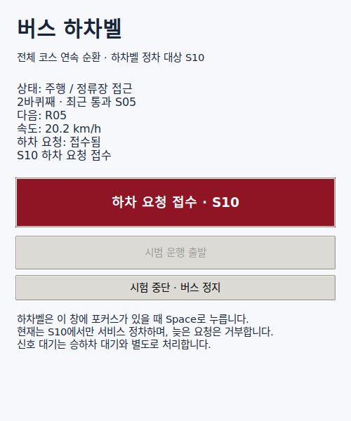

# S10 서비스와 전체 코스 연속 순환 — 2026-10-26

빈 도로의 Town05 / Fuso Rosa / GT 객체·신호 구성으로 연속 순환과 무작위 하차벨을 검증한다.
서비스 대상은 S10 한 곳이며, S01은 다음 바퀴로 이어지는 경유점이다.
정류장 10곳 모두의 서비스나 배경 교통 통합 검증은 아니다.

## 최종 결과

`random-26026-03`에서 **사용자 개입 없이 두 바퀴 4,021.57m**를 완료했다.
충돌 0건, 기록된 정지선 통과는 녹색 27회·황색 1회이며 적색/미상 통과는 검출되지 않았다.
실제 최고 속도는 도심 27.67km/h, 순환로 48.47km/h다.

| 확인 항목 | 결과 |
|---|---|
| 첫 바퀴 무요청 | S10 23.49km/h 통과. 목표 전후 10m 표본의 최소 속도 11.59km/h |
| 순환 경계 | S01을 첫 바퀴 27.58km/h, 두 번째 바퀴 18.42km/h로 AUTO 통과 |
| 무작위 벨 | 두 번째 바퀴 S10까지 695.65m 남은 시점에 21.00km/h로 접수. 출처 `random_test`, 입력 1회 |
| 서비스 정차 | S10 road 43/lane -2, 실제 정지 5.00초. 목표 대비 종방향 -0.7565m·횡방향 -0.0042m |
| 요청 유지·해제 | 신호 대기에도 유지, 서비스 완료 시 해제. 실제 5.26m 이동으로 재출발 확인 |
| 종료 | S01 이후 별도 검증 종료점 정지. STOP·속도 제한 해제·경로 해제 확인, 실행 종료 코드 0 |

정차 오차는 차로 중심에서 안쪽으로 0.45m 보정한 rear axle/base_link 목표 기준이다.
계획한 무요청/요청 두 조건과 실제 서비스 결과가 일치했다. 서비스 후 다음 바퀴 전체를
추가 주행한 시험이나 무한 운행의 장시간 내구 시험은 아니다.

**일시적 긴급 상태 5회는 모두 회복했다.** 과도한 감속 진단 1회, 경로 급변 관련 2회,
S06 출구 부근 긴급 상태 2회가 남았다. 무진행 실패는 수정했지만 승차감·안전 진단과
차체의 모든 순간 경계 내 수용까지 해결한 것으로 보지 않는다.

## 재현

```bash
./scripts/carla/run_bus_service /tmp/bus-loop-random --continuous --laps 2 --random-bell-seed 26026 --auto-start
```

시드 26026은 첫 바퀴 무요청, 두 번째 바퀴 노선 진행률 약 1,251.4m에서 요청하도록 선택한다.
절대 진행률은 약 3,283.5m이며, S10까지 약 695.9m를 남긴 시점이다.
자동 시험에서는 버튼·Space 입력을 잠그고 `source: random_test`인 입력만 접수한다.
검증은 두 바퀴 뒤 S01에서 12m 지난 별도 종료점에 정지하며, 이 정지는 하차벨과 무관하다.

## 개발 중 중단·실패

- `random-26026-01`: 첫 바퀴 무요청 계획과 다른 자동 스케줄 외 벨 입력이 감지돼 시험을 중단했다.
  입력 주체를 추정하지 않고, 이후 입력 출처 기록과 자동 시험 중 수동 입력 잠금을 추가했다.
  STOP과 경로 해제는 확인했다.
- `random-26026-02`: 첫 바퀴 S10 무요청 통과(23.5km/h), S01 통과(26.2km/h)는 성공했다.
  두 번째 바퀴 S03 뒤에서 `outside_drivable_area` 정지 요인이 약 0.30m 앞에 발생하고,
  차로 변경 완료점 약 1.63m를 남긴 채 정지했다. 120초 무진행 감시로 실패 처리했고
  STOP·경로 해제를 확인했다. 두 바퀴 완료나 무작위 벨 서비스 성공으로 집계하지 않는다.
  수정본은 서비스 대상이 아닌 S03에서 연결된 출구 차로를 미리 선택하며,
  다음 바퀴 S10 경로 연장 시점을 S03 이후에서 S01 직후로 앞당겼다.
  차량 경계·경로 변경 안전 검사를 완화하지 않았다.
  `random-26026-03`에서는 두 바퀴 모두 S03을 출구 차로로 통과하고 완주했다.

## 기록 읽기

[상세 결과](results.json)의 `random_comparison`으로 계획된 요청/무요청과 실제 S10 서비스를 비교한다.
`lap_crossings`는 S01을 지난 시점의 속도와 AUTO 상태, `service_events`는 실제 위치·속도와
5초 대기, `restart_events`는 서비스 이후 재출발을 기록한다.
일시적 긴급 상태는 연속된 true 메시지 수가 아니라 false→true 전환별 에피소드로 집계한다.

각 `*.json.gz`, `*.log.gz`는 원본 결과와 이벤트 로그다. `*-inputs.json`에는 실행 당시
Git 기준점, 실행 이미지와 소스 해시가 있다. 변경 중인 작업 트리에서 실행했으므로
Git 기준점만으로 실행 코드를 식별하지 말고 소스 해시를 함께 확인한다.

## UI와 자동 검사



[다른 빨간색 표본](panel-request-alt.png) · [신호 대기](panel-signal-wait.png) ·
[서비스 후 요청 해제](panel-after-service.png) · [완료 화면](panel-complete.png)

실제 주행 중 빨간색 두 색상, 두 번째 바퀴 표시, 신호 대기와 서비스 후 요청 해제를 확인했다.
주행 완료 뒤 완료 화면이 다음 바퀴 번호와 일반 대기 이유를 보여주는 표시 문제를 수정했다.
`panel-complete.png`는 저장된 성공 결과를 수정된 UI에 재생한 화면이며 차량 제어를 실행하지 않았다.
수정 전 실제 종료 화면은 [panel-complete-live.png](panel-complete-live.png)에 보존한다.
주행 검증 이후 소스 변경은 `carla_bus_service.py`의 완료 문구·자동 시험 안내 표시뿐이다.
[주행 검증 이후 UI 변경분](post-run-ui.patch)을 별도로 보관했으며, 나머지 실행 소스 해시는
최종 작업 트리와 일치함을 확인했다.

순환 진행률·난수 일정 5개와 기존 벨·노선·순환로·신호·후행 정책을 합친 **32개 테스트**가
통과했다. Python·실행 스크립트 구문과 변경 사항의 공백 검사도 확인했다.

실행 방법과 정차 기준은 [하차벨 안내](../../carla-bus-service.md)를 따른다.
