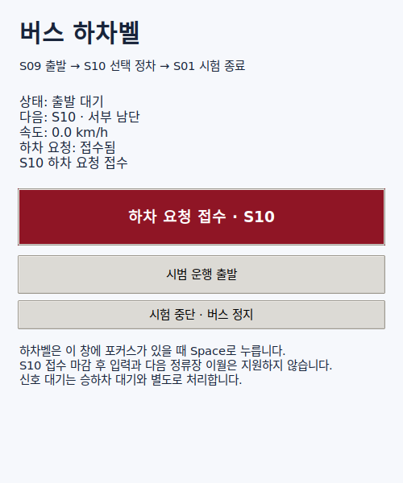

# S10 하차벨 서비스 검증 — 2026-10-26

S09→S10→S01의 빈 도로 구간에서 **벨 요청 서비스 5회, 무요청 통과 1회**를
S01 목표 정지까지 완료했다. 모두 충돌 0건, 검출된 적색/미상 정지선 통과 0건이다.
추가 무요청 시험은 S10 통과 뒤 사용자의 직접 Space 시험을 위해 중단했으며 완료 횟수에 넣지 않았다.

| 시험 | 결과 |
|---|---|
| 출발 전 벨 | S10 road 43/lane -2 정차, 5초 대기, 요청 해제·재출발, S01 정지 |
| 주행 중 벨 | 약 10km/h, S10까지 약 59.6m에서 접수. Autoware 재경로 승인 뒤 같은 서비스 수행 |
| UI Space·버튼·중복 입력 | 실제 키·마우스 입력으로 요청 유지 확인. 여러 입력에도 서비스는 한 번 수행 |
| 빨간색 깜빡임 UI | 접수 뒤 빨간색 두 색상 전환을 화면 표본으로 확인. 서비스 완료 후 요청 해제와 깜빡임 종료 확인 |
| 사용자 직접 Space·출발 | S10 서비스 완료·요청 해제·재출발을 확인. 이후 신호 대기와 S01 시험 종료 정지를 별도로 기록 |
| 무요청 | S10을 약 18.6km/h로 통과. 이후 교차로 신호 대기는 서비스로 처리하지 않음 |

서비스 5회의 종방향 정차 오차는 약 0.71~0.75m, 횡방향 오차는 약 0.9~3.2cm다.
이는 차로 중심에서 안쪽으로 0.45m 보정한 rear axle/base_link 목표 기준이다.
각각 시뮬레이션 시간 5초 동안 실제 속도 0.05m/s 미만을 유지했다.
재출발은 실제 5m 초과 이동과 0.5m/s 초과 속도로 확인했다.
최종 정리에서 STOP, 시험 속도 제한 해제, 경로 해제가 모두 확인됐다.

**S01은 벨과 관계없이 멈추는 시험 종료 목적지다.** 사용자 직접 시험(`manual-space`)에서도
S10에서 요청을 해제한 뒤 `terminal_stop`으로 S01에 멈췄다. 현재 시범 버전은 계속 순환하는
서비스 운행이 아니며, 벨이 없을 때의 S01 종료 정지는 추가 하차 요청으로 처리하지 않는다.

[상세 결과](results.json)에 시험별 수치, 입력 이벤트, 종료 상태와 원본 JSON 해시를 기록했다.
각 `*.json.gz`는 원본 결과 JSON을 압축한 파일이다. `*-inputs.json`은 해당 실행 당시의
소스 해시와 이미지 ID다. 초기 개발 시험에는 입력 해시 파일이 없으며 이후 시험부터 추가했다.

## 초기 실패와 중단

- `bell-before-01`: 최초 S02 목표가 차량 전체 외곽 검사에서 거부됐다. 검사나 지도 폭을
  변경하지 않고 기존 정지·재출발 근거가 있는 S10을 첫 서비스 정류장으로 선택했다.
- `s10-bell-before-01`: S10에 정지했으나 목표 도착에 따른 정상 STOP 전환을 오류로
  처리했다. 올바른 차로·위치·정지 속도를 만족할 때 STOP에서도 5초를 세도록 수정했다.
- `s10-bell-gui-01`: 컨테이너의 한글 글꼴 누락을 발견해 출발 전에 창을 닫았다.
  실행 도구에 호스트 한글 글꼴 설치를 추가하고 다시 검증했다.
- `s10-no-bell-01`: 주행과 STOP은 성공했으나 실행 도중 런처 파일을 편집해 마지막
  결과 복사 구문이 실패했다. 컨테이너에 저장된 원본 JSON을 변경 없이 회수했다.
  이후 실행에서는 자동 결과 복사까지 확인했다.
- `s10-no-bell-02`: 사용자에게 직접 Space 입력을 넘기기 위한 의도적 중단이다.
  S10 무요청 통과와 최종 STOP·경로 해제를 확인했지만 구간 완료로 기록하지 않았다.

## UI와 자동 검사

[출발 대기 화면](panel-ready.png) · [서비스 완료 화면](panel-complete.png)

UI는 실제 창을 열어 한글, 버튼, Space, 반복 입력, 빨간색 전환과 완료 후 해제를 확인했다.
순수 상태 정책 7개와 기존 노선·순환로·신호·후행 정책을 합친 **27개 테스트**가 통과했다.
Python 구문, 실행 스크립트 구문과 `git diff --check`도 확인했다.

## 범위와 남은 작업

이 시험은 GT 객체·신호를 쓰는 빈 도로 단일 정류장 시범 운행이다. 모든 정류장의 서비스,
승객 판단, 교통 차량과 서비스 정차의 통합, 늦은 벨의 다음 정류장 이월, 승차감과 차체의
모든 순간 경계 내 수용까지 검증한 것은 아니다. 늦은 벨은 현재 명시적으로 거부한다.
무요청의 완료 반복 횟수는 1회이며, 전체 서비스 평가에 필요한 반복 검증은 후속 작업이다.

실행 방법과 정차 기준은 [하차벨 안내](../../carla-bus-service.md)를 따른다.
