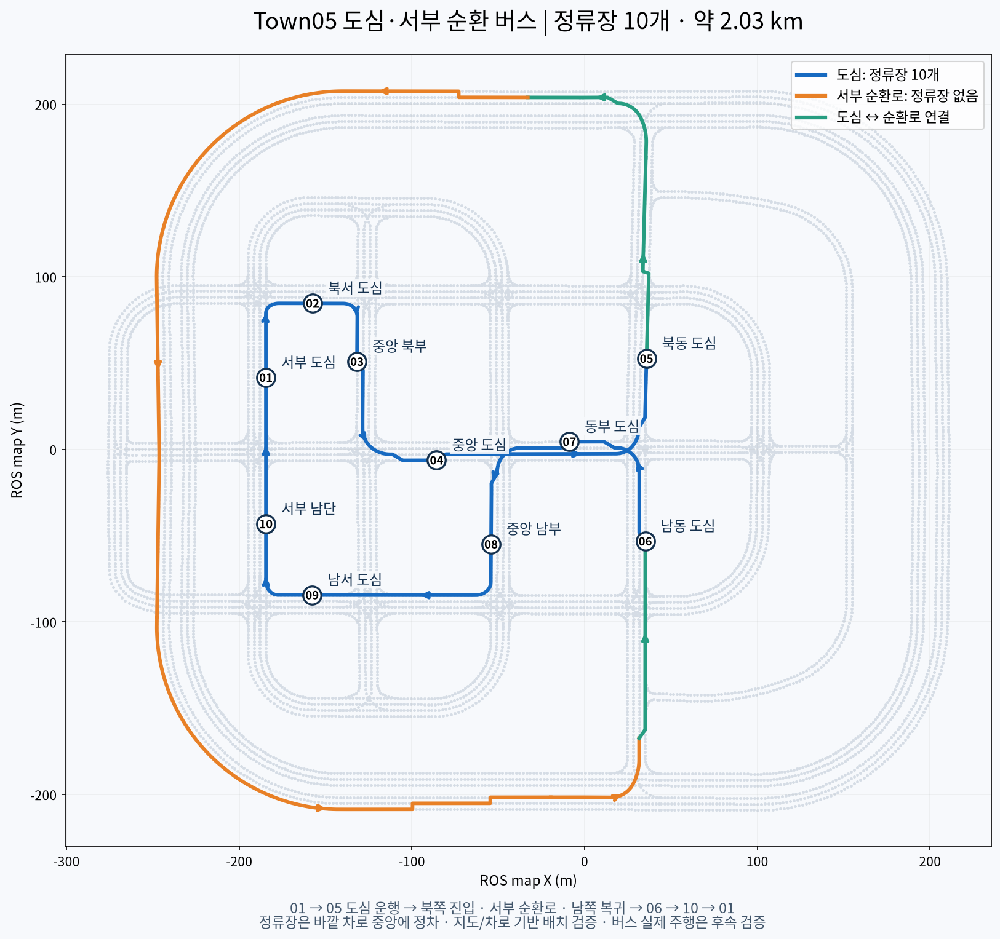

# Town05 도심·서부 순환 버스 노선

2026-10-22. 정류장 10개를 모두 도심에 배치했다. 별도 버스베이 없이
정류장이 있는 **바깥 주행 차로의 중앙**에서 정차하는 미션이다.
정류장 명칭은 이번 미션의 구역별 이름이며 CARLA의 실제 시설명이 아니다.



## 운행 순서

**S01 → S02 → S03 → S04 → S05 → 북쪽 연결로 → 서부 순환로 →
남쪽 연결로 → S06 → S07 → S08 → S09 → S10 → S01**.

전체 참조 노선은 약 2.02km다. 외곽 순환로 전체를 한 바퀴 도는 노선은 아니며,
북쪽에서 진입해 서쪽·남서쪽 구간을 이용한 뒤 남쪽으로 도심에 복귀한다.
순환로에는 정류장을 두지 않는다. 도심 정류장 사이의 거리는 약 56~168m,
순환로를 포함한 S05→S06은 약 1.17km다.

| 번호 | 명칭 | CARLA road / lane | ROS map X / Y (m) |
|---|---|---|---|
| S01 | 서부 도심 | 44 / -2 | -184.58 / 41.59 |
| S02 | 북서 도심 | 8 / 2 | -157.53 / 84.63 |
| S03 | 중앙 북부 | 5 / -2 | -131.84 / 50.91 |
| S04 | 중앙 도심 | 1 / 2 | -85.74 / -6.26 |
| S05 | 북동 도심 | 16 / 2 | 35.84 / 52.63 |
| S06 | 남동 도심 | 29 / -2 | 35.09 / -53.22 |
| S07 | 동부 도심 | 0 / -2 | -8.83 / 4.43 |
| S08 | 중앙 남부 | 40 / -2 | -54.19 / -54.89 |
| S09 | 남서 도심 | 23 / -2 | -157.79 / -84.39 |
| S10 | 서부 남단 | 43 / -2 | -184.56 / -43.19 |

## 파일과 좌표

- `config/carla/bus/town05_route_spec.json`: 편집 원본. OpenDRIVE road/lane/s로 위치 지정.
- `town05_bus_route.json`: 정류장, Lanelet2 ID, 순서, 참조 경로와 차선 변경 요구사항.
- `town05_bus_stops.csv`: 정류장별 CARLA/ROS 좌표, 방향, 누적 거리.
- `town05_bus_route.png`: 발표·검토용 노선도.

ROS map 좌표는 CARLA의 `(x, -y, z)`이고 yaw 부호도 반대다.
정차 기준점은 도로 중심선상의 기준 좌표이며, 버스 프로필을 적용할 때
base_link·차체 중심·앞부분 중 어디를 맞출 것인지 일관되게 보정해야 한다.

노선 JSON의 샘플은 **경로 참조**다. 차선 변경 구간을 포함한 실제 주행 궤적은
Autoware가 생성해야 한다. 이 JSON을 직접 차량 제어에 보내지 않는다.
정류장마다 항상 멈추는 OSM 정지 표지 규제를 추가하지 않았다.
하차벨이나 대기 승객이 있는 경우에만 서비스 정차하도록 미션 관리자가 연결할 예정이다.

## 생성 및 CARLA 표시

시뮬레이터 없이 지도 파일만으로 재생성:

```bash
cd /home/a/carla_pp
/home/a/CARLA/venv-0.9.16/bin/python tools/map/generate_town05_bus_route.py
```

Town05가 실행 중이면 임시 선과 정류장 번호 표시:

```bash
/home/a/CARLA/venv-0.9.16/bin/python tools/carla_bus_route_preview.py --duration 120
```

표시는 120초 뒤 사라지지만 정류장 정의 파일은 유지된다. 이 명령은 차량을 생성하거나
운전하지 않고, 월드 재시작·tick·지도 수정도 수행하지 않는다.

Town05가 실행 중일 때 정지 버스와 정류장별 카메라 버튼을 함께 확인하려면:

```bash
./scripts/carla/carla_bus_inspection
```

확인 패널은 S01에 미리보기 버스 한 대를 생성하고 주차 브레이크를 적용한다.
`버스 보기`, `노선 전체 내려다보기`, 정류장 01~10 버튼은 카메라만 이동한다.
패널이 열린 동안 정류장 표시를 갱신하고, 닫으면 미리보기 버스만 정리한다.
Autoware나 자율주행은 시작하지 않는다. S01이 다른 객체로 막혀 있으면 생성을 거부한다.

## 검증과 남은 작업

10개 모두 교차로 밖의 가장 오른쪽 주행 차로이며, 정차 기준점이 실제 Lanelet2
도로 폴리곤 한 개에 들어가는 것을 확인했다. 기준점과 횡단보도 사이 최단거리는
15.94~30.00m다. 전후 9m 차로에 교차로가 없음을 확인했다.
16개 경유 구간의 CARLA 방향성 경로 생성과 순환 연결을 검사했다.

CARLA Town05에서 정류장 표시를 실행했다. Fuso Rosa 버스를 별도 생성해 정지 상태와
차체·바퀴 물리 값을 확인한 뒤 시험 객체를 정리했다.
CARLA가 보고하는 버스 폭은 약 3.94m이고 정류장 차로 폭은 3.5m다.
따라서 이 자료는 기준점의 배치 검증이며, 버스 외곽의 차로 내 수용·충돌 없는 회전·
정차 정확도까지 검증한 것은 아니다.

Autoware RouteHandler 연결 검사, 버스 프로필 적용·주행, 조건부 정차·재출발,
대기 승객 영역, 하차벨 UI는 후속 작업이다.
검증 기록은 `docs/validation/carla-bus-route-20261022/`에 보관했다.
전체 동작 요구사항은 [미션 설계](../../docs/carla-bus-mission.md)를 따른다.
